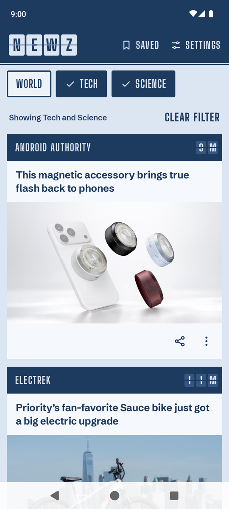
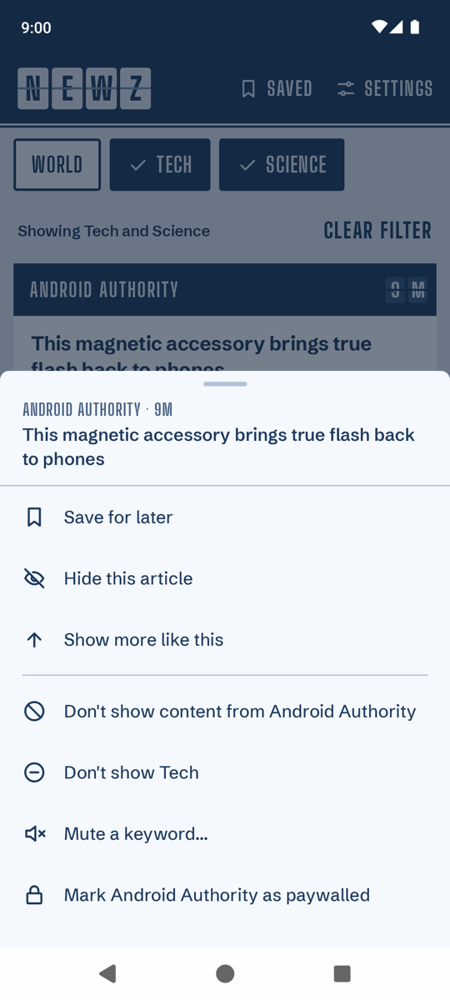
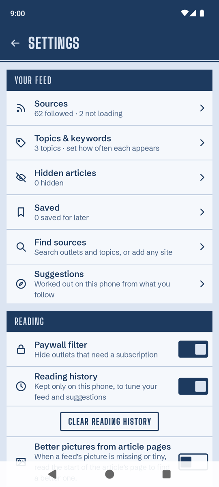
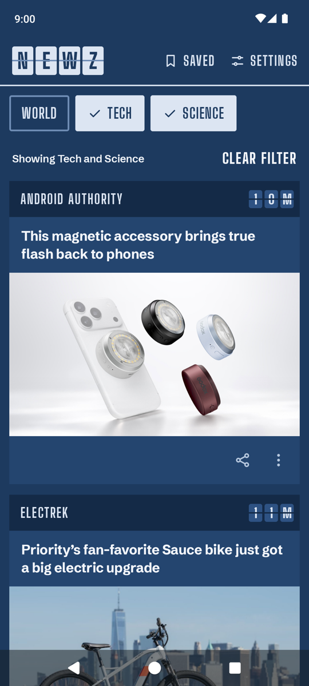

# Newz

A privacy-first news reader for Android. Newz builds your feed straight from publishers' own RSS
feeds, on your phone. It has no account, no server, no analytics, and it never contacts Google.

Newz was built with [Relay](https://github.com/mack5imal/relay), my free plugin for Claude Code
that plans a project with you and then builds it fully autonomously. Newz was built in a single
autonomous run, then polished through a couple of hours of hands-on testing and bug fixes.

<p align="center">
  
  
  
  
</p>

## What it does

- **One feed from hundreds of outlets.** A built-in catalog of 343 outlets and 477 feeds across 20
  topics, plus any site you add yourself by address or search.
- **No paywall dead ends.** The paywall filter, on by default, keeps outlets that lock their
  articles behind a subscription out of your feed, so every headline you tap is one you can
  actually read. Outlets with a few free articles a month stay in, marked "Metered". If an outlet
  starts blocking you, mark it paywalled from any of its cards and it disappears (undo it in
  Settings › Sources).
- **Same story, one card.** Articles about the same event from different outlets are grouped
  together on the device, so a big story shows up once rather than ten times.
- **You decide what you see.** Follow topics and set how often each appears, mute keywords, hide
  stories or whole outlets, and use "Show less like this" on any card.
- **Local news without location tracking.** Type a zip code once; it is matched to a metro area
  using a table that ships with the app and never leaves the device.
- **Works offline.** Articles are cached on the phone, and saved articles stay readable.
- **Your data stays yours.** Reading history is optional and on-device only. Settings, follows,
  mutes and saved articles can be exported to a file and imported again.

Articles open in your browser's in-app tab. Newz shows headlines and pictures from the feeds; it
does not copy or host articles.

## Privacy

Newz's core rule is **zero contact with Google servers**, and the code enforces it rather than
relying on good intentions:

- Every network request goes through one gate, [`HostGuard`](shared/src/commonMain/kotlin/app/newz/net/HostGuard.kt),
  which refuses any Google-owned host (google.\*, gstatic, googleapis, YouTube, Blogger,
  FeedBurner, DoubleClick, Firebase and more). Feeds, pictures and discovered sites are all
  checked, including after redirects.
- No Google Play Services, Firebase, analytics, crash reporting or ad libraries. The release
  check script fails the build if any of them appear in the dependency tree.
- The app asks for two permissions only: internet access and network status.
- There is no Newz server. The only requests the app makes are to the publishers whose feeds
  you follow, identified by a plain User-Agent: `Newz/1.0 (+https://github.com/mack5imal/newz; RSS reader)`.

The browser you choose for opening articles has its own privacy policy; Newz uses whichever
browser is your default.

## Install

Newz is not in the Play Store, so you build the APK yourself and sideload it onto your phone
(Android 10 or newer).

**[INSTALL.md](INSTALL.md) describes the setup it was written for**: an Apple-silicon Mac and a
Samsung phone. Your computer, phone and Android version may differ in ways those steps don't
cover, such as different menu names, USB settings or toolchain paths. The easiest route is to
ask your coding agent to walk you through it: tell it your computer, your phone model and
Android version, and have it use INSTALL.md as a starting point while it adapts each step to
your setup.

## Build

> **Scan before you build.** Treat this repo like any code you download from the internet:
> before you build or run it, ask your coding agent (Claude Code, Codex, Cursor or similar) to
> review it for security problems, such as hidden network calls, malicious build scripts or
> suspicious dependencies. It takes a few minutes and is a good habit for every repo you clone.

Requirements: a Mac or Linux machine with JDK 17 and the Android SDK (compileSdk 37).
`scripts/setup-android-toolchain.sh` installs both on macOS without admin rights.

```bash
bash scripts/make-release-key.sh          # once: creates your signing key in keystore/
./gradlew :androidApp:assembleRelease     # builds androidApp/build/outputs/apk/release/androidApp-release.apk
bash scripts/verify-release.sh            # checks signing, permissions and that no Google/tracker libraries are present
```

Back up the `keystore/` folder: Android only installs updates signed with the same key.

### Tests

```bash
./gradlew :shared:jvmTest                 # engine, store and parser tests
./gradlew ktlintCheck                     # formatting
bash scripts/run-instrumented-tests.sh    # UI tests: boots the newz-api34 emulator headless, runs them, shuts it down
```

The UI test run uninstalls and reinstalls the app, which wipes its data. Run it on a test
emulator, never on a phone you use.

## Project layout

| Path | What's there |
|---|---|
| `shared/` | Kotlin Multiplatform core: feed fetching and parsing, story grouping, ranking, filtering, storage (SQLDelight, DataStore), and `HostGuard` |
| `androidApp/` | The Android app: Jetpack Compose UI, screens and view models |
| `catalog/` | The outlet/feed catalog, the zip-to-metro table, and the data notices |
| `design/` | The design handoff: screen mockups, tokens and the HTML they were rendered from |
| `scripts/` | Toolchain setup, release key and checks, catalog and data builders |

Built with Kotlin 2.4, Compose Multiplatform, Ktor (OkHttp engine), SQLDelight, DataStore,
Coil 3 and [RSS-Parser](https://github.com/prof18/RSS-Parser).

## Data sources and credits

- Zip-code to metro table: US Census Bureau, public domain. See [catalog/ZIP-DATA-NOTICE.md](catalog/ZIP-DATA-NOTICE.md).
- Outlet popularity scores: derived from the Majestic Million, CC BY 3.0. See [catalog/POPULARITY-NOTICE.md](catalog/POPULARITY-NOTICE.md).
- Story-grouping test data: UCI News Aggregator Data Set, CC BY 4.0. See [shared/src/commonTest/resources/dedup/NOTICE.md](shared/src/commonTest/resources/dedup/NOTICE.md).
- Fonts: Big Shoulders Display and Schibsted Grotesk, SIL Open Font License 1.1 (texts in
  `androidApp/src/main/assets/licenses/`).

Outlet names and feeds belong to their publishers. Newz is not affiliated with any of them.

## Security

To report a security or privacy problem, see [SECURITY.md](SECURITY.md).

## License

Copyright (C) 2026 Kyle Mack

Newz is free software: you can redistribute it and/or modify it under the terms of the
[GNU General Public License version 3](LICENSE) as published by the Free Software Foundation.
If you share a modified version, you must make its source available under the same license.

Newz is distributed in the hope that it will be useful, but WITHOUT ANY WARRANTY; without even
the implied warranty of MERCHANTABILITY or FITNESS FOR A PARTICULAR PURPOSE. See the license
for details.
